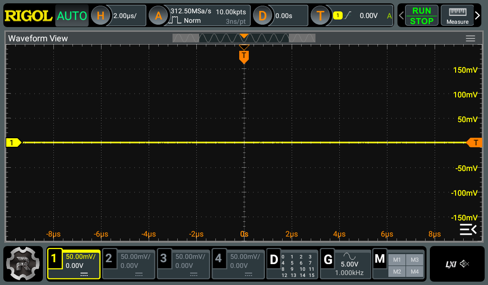

# rigol-mcp

[](https://github.com/eljefedelrodeodeljefe/rigol-mcp/actions/workflows/ci.yml)
[](https://github.com/eljefedelrodeodeljefe/rigol-mcp/releases)
[](LICENSE)
[](https://modelcontextprotocol.io)

**Let an AI agent drive your bench: RIGOL power supplies and oscilloscopes over SCPI, with
safety limits enforced in the library, below the MCP layer.**

A Rust SDK and an [MCP](https://modelcontextprotocol.io) server. Point Claude Code, Cursor or
any MCP client at a DP800 power supply and a DHO800/DHO900 or MHO900 oscilloscope, and ask it
to power a rail and catch the rise on the scope.



*The scope's screen as an agent sees it, returned as an image by `get_screenshot`.*

## Supported instruments

| Family (`RIGOL_FAMILY`) | Models | Verified against |
|---|---|---|
| `dp800` (default) | DP811, DP821, DP831, DP832, DP832A | DP832A, firmware `00.01.19` |
| `dho900` | DHO802, DHO804, DHO812, DHO814, DHO914(S), DHO924(S) | DHO924S, firmware `00.01.05` |
| `mho900` | MHO934, MHO954, MHO984 | MHO984, firmware `00.01.00`: read paths only (see below) |

On the MHO900, every read tool has been run against an MHO984. The write tools and the signal
generator have **not** been run on hardware: their commands come from the MHO900 Programming
Guide, and the test unit has no generator option. The MHO98 has its own Programming Guide and
is not covered.

One process drives one instrument. A PSU and a scope are two server entries, each with its own
address and its own write gate. A scope can be writable while the PSU stays read-only, and a
stuck scope session cannot block a PSU `output_off`.

## A wrong write can destroy the board under test

**This drives real power into real hardware, and a wrong write can cost you a board.** The
design follows from that:

1. **Ceilings are enforced in the library**, below the MCP layer. No tool argument, prompt
   or future caller can bypass them. A caller does not see the check; it gets an error.
   - PSU: per channel, volts and amps.
   - Scope signal generator: amplitude, and the **peak** `|offset| + amplitude/2` that
     reaches the device under test. Each can be in range while the
     pair is not. On an MHO900 each of the two generator channels has its own ceilings.
2. **Every ceiling has a finite default.** Unconfigured, it is what the hardware can do:
   the channel's own rating on a PSU (30V/3A, 30V/3A, 5V/3A on a DP832A), the generator's own
   10 Vpp / 5 V peak on a DHO, and 20 Vpp / 10 V peak on an MHO900.
3. **Configuring and energising are separate operations.** Setting a voltage never turns a
   PSU output on; configuring the generator never turns its output on. Every energisation is
   explicit and logged, and both the PSU and the generator re-check their settings at
   output-on, in case they were changed on the front panel. When the generator output is
   already on, settings change in an order that keeps every intermediate state inside the
   ceilings too.

**On an MHO900 the generator ceilings bound the open-circuit voltage.** An MHO900 states
amplitude and offset into the load its output impedance is set to (`:SOURce<n>:IMPedance`).
Set to 50 Ω, a 5 Vpp setting is 5 Vpp across a 50 Ω termination but 10 Vpp across an
unterminated input, and the generator has no way to know which is connected. The library
reads the impedance setting before every configure and output-on, doubles a 50 Ω setting,
and checks that against the ceilings. The default, 20 Vpp / 10 V, is the hardware's HighZ
range, the most either setting can put on an open circuit. A ceiling of 3.3 V peak then means
3.3 V at the device under test, terminated or not.

A refused value comes back as an MCP *invalid params* error. That code tells the model to
change the arguments, so it lowers the value instead of retrying the same call.

`RIGOL_ALLOW_WRITES` gates mutating tools. **It guards against an agent's mistakes and gives
no protection from an attacker:** anyone who can reach tcp/5555 can drive the instrument
directly, with or without this server.

The ceilings likewise constrain *this client only*. The front panel and any other LAN
client are unaffected, so the ceilings do not replace a hardware interlock.

On a PSU, **instrument-side protection** is the safeguard that does reach the front panel
and every other client: with OVP or OCP on, the supply itself turns the output off above the
trip level. It ships **off**, with trip levels above the channel ratings (33 V / 3.3 A on a
30 V / 3 A DP832A channel). `set_protection` sets the levels, refused above the ceilings
like any setpoint, and then switches protection on; `get_protection` and `set_protection`
warn when protection is on but its level is above the ceiling, because it cannot trip before
a setpoint this server would refuse anyway.

## Install

**Release binary** (Linux and macOS, x86_64 and aarch64): download from
[Releases](https://github.com/eljefedelrodeodeljefe/rigol-mcp/releases), unpack, and put
`rigol-mcp` on your `PATH`. Each release also carries a CycloneDX and SPDX SBOM.

**With cargo:**

```sh
cargo install --locked --git https://github.com/eljefedelrodeodeljefe/rigol-mcp rigol-mcp
```

**From source:**

```sh
git clone https://github.com/eljefedelrodeodeljefe/rigol-mcp.git
cd rigol-mcp
cargo build --release   # binary at target/release/rigol-mcp
```

## Use with an MCP client

Claude Code, one instrument:

```sh
claude mcp add rigol-scope --env RIGOL_FAMILY=dho900 --env RIGOL_HOST=192.0.2.20 -- rigol-mcp
```

A PSU and a scope side by side, in `.mcp.json`:

```json
{
  "mcpServers": {
    "rigol-psu": {
      "command": "rigol-mcp",
      "env": {
        "RIGOL_FAMILY": "dp800",
        "RIGOL_HOST": "192.0.2.10",
        "RIGOL_CH1_MAX_VOLTS": "3.6",
        "RIGOL_CH1_MAX_AMPS": "0.5"
      }
    },
    "rigol-scope": {
      "command": "rigol-mcp",
      "env": {
        "RIGOL_FAMILY": "dho900",
        "RIGOL_HOST": "192.0.2.20",
        "RIGOL_ALLOW_WRITES": "true",
        "RIGOL_GEN_MAX_VPP": "3.3",
        "RIGOL_GEN_MAX_PEAK_VOLTS": "1.65"
      }
    }
  }
}
```

Here the scope is writable and the PSU is read-only. An agent can arm the scope with `single`,
and you switch the rail on yourself. Once you trust the ceilings, set `RIGOL_ALLOW_WRITES` on the
PSU too.

## Tools

### Power supply (`RIGOL_FAMILY=dp800`)

| Tool | What it does | Gate |
|---|---|---|
| `get_identity` | Vendor, model, serial, firmware (`*IDN?`) | — |
| `get_channel` / `list_channels` | Rating and setpoints (`:APPLy?`) | — |
| `measure_channel` | Delivered volts, amps, watts (`:MEASure:ALL?`) | — |
| `get_output_state` | Output on or off (`:OUTPut?`) | — |
| `get_protection` | OVP/OCP on/off, levels and trip state, with the same warnings | — |
| `get_safety_limits` | Ceilings in force | — |
| `get_lan_config` / `get_instrument_errors` | LAN subsystem, error queue | — |
| `set_voltage` / `set_current` | Setpoints, refused above the ceiling | writes |
| `set_protection` | OVP/OCP trip levels and on/off; levels first, warns when an armed level is above the ceiling | writes |
| `output_on` / `output_off` | Energise or de-energise a channel | writes |

### Oscilloscope (`RIGOL_FAMILY=dho900` or `mho900`)

Both scope families have the same tools. On an MHO900 the four generator tools take a
`channel` (1 or 2, `:SOURce<n>`), and are refused when the scope has neither the
MHO900-AFG50 nor the MHO900-AFG100 option (`:SYSTem:OPTion:STATus?`).

| Tool | What it does | Gate |
|---|---|---|
| `get_screenshot` | The screen, as an image (`:DISPlay:DATA? PNG`) | — |
| `get_status` | Trigger, timebase, acquisition, every channel (and its input impedance on an MHO900) | — |
| `measure` | One automatic measurement (`:MEASure:ITEM?`); `null` when unmeasurable | — |
| `measure_statistics` | Current/min/max/average/deviation/count for one measurement (`:MEASure:STATistic:ITEM?`) | — |
| `get_waveform` | A trace in volts/seconds, thinned to min/max buckets, with full-capture stats | — |
| `save_waveform` | The whole acquisition record of one channel, from memory, to an `.npz` and sidecar on the host (see below) | — (writes to stop a running scope) |
| `get_identity` / `get_lan_config` / `get_instrument_errors` | Identity (with channel count), LAN, error queue | — |
| `get_generator` | Signal generator state and its ceilings | — |
| `get_logic_analyzer` | Logic analyser on/off, pod thresholds, which of D0–D15 are shown (DHO900, MHO900) | — |
| `run` / `stop` / `single` / `autoset` | Acquisition control | writes |
| `configure_channel` / `configure_timebase` / `configure_edge_trigger` | Setup; returns the values the scope reads back. The edge trigger takes an analog channel or a digital channel D0–D15 | writes |
| `clear_measurements` | Empty the on-screen measurement list (`:MEASure:CLEar`; `:MEASure:DELete` on an MHO900) | writes |
| `reset_measurement_statistics` | Restart every item's statistics (`:MEASure:STATistic:RESet`) | writes |
| `configure_logic_analyzer` | Logic analyser on/off, show/hide D0–D15, pod thresholds (DHO900, MHO900) | writes |
| `configure_generator` | Waveform, frequency, amplitude, offset (output stays off) | writes |
| `generator_output_on` / `generator_output_off` | Drive or stop the signal | writes |

Every tool's description names the SCPI command it sends, in Programming Guide terms.

### Full records: `save_waveform`

`get_waveform` reads the on-screen trace (1000 points) and thins it for the model.
`save_waveform` reads the **whole record** in the scope's memory, up to the memory depth
(100 Mpts on an MHO984 with one channel on, 25 Mpts with four), and writes it to a file on the
host running the server, not into the conversation.

| Parameter | Meaning |
|---|---|
| `channel` | Analog input, 1 to the model's channel count |
| `path` | Absolute path ending in `.npz`, in an existing directory. The sidecar is the same path with `.json`. Neither file may exist: nothing is ever overwritten |
| `stop_if_running` | Default `false`. See below |
| `expect_impedance` | `fifty_ohm` or `one_megohm`: refuse unless the input is set to it (`:CHANnel<n>:IMPedance?` on an MHO900; a DHO input is always 1 MΩ) |
| `chunk_points` | Points per `:WAVeform:DATA?` block, default 1 000 000 (2 MB), at most 10 000 000 |

It follows the Programming Guide's procedure for reading the internal memory (3.28.5 in both
the DHO800/DHO900 and MHO900 guides): `:WAVeform:MODE RAW`, `:WAVeform:FORMat WORD`, and
`:WAVeform:STARt` / `:WAVeform:STOP` per block. The guides set no block size limit beyond the
memory depth. Each block goes to disk as it arrives, so memory use stays at about one block,
whatever the record length.

**RAW reads need the scope stopped.** "The data in the internal memory can only be read when
the oscilloscope is in the Stop state" (`:WAVeform:MODE`, 3.28.2). A stopped scope, for example
after a `single` capture, is read as it is: only the waveform transfer settings change, and
they go back to what `get_waveform` uses afterwards. A running scope is refused, unless
`stop_if_running` is `true`. That requires `RIGOL_ALLOW_WRITES`: the tool sends `:STOP`, reads,
and restarts the acquisition with `:RUN` (or `:SINGle` if the sweep is single), on failure too.
Both commands are logged. No other call to the server's scope gets in between, as the guide
requires; the front panel can, and a record that changed during the read (the scope no longer
stopped, or its scaling different at the end) is an error rather than a file.

The `.npz` loads with `numpy.load`:

| Array | Type | Content |
|---|---|---|
| `codes` | `uint16`, one per sample | Raw WORD codes as read |
| `volts` | `float64`, one per sample | `(codes − y_origin − y_reference) × y_increment` |
| `time` | `float64`, one per sample | Seconds, `x_origin + (i − x_reference) × x_increment`; `x_increment` is 1/sample rate |
| `x_increment`, `x_origin`, `x_reference`, `y_increment`, `y_origin`, `y_reference` | `float64` scalars | `:WAVeform:PREamble?` in RAW mode |
| `sample_rate`, `volts_per_div`, `offset_volts`, `probe_ratio`, `input_impedance_ohms`, `seconds_per_div`, `timebase_offset_seconds` | `float64` scalars | Settings read back before the transfer |
| `trigger_position` | `float64` scalar | `:TRIGger:POSition?`; NaN if the scope did not answer |
| `channel`, `points`, `memory_depth` | `int64` scalars | `points` is shorter than `memory_depth` only if the memory ran out first |

The JSON sidecar holds the instrument identity and family, the preamble as parsed and as sent,
the channel setup, acquisition, timebase and trigger settings read back, how the transfer ran
(blocks, whether the scope was stopped for it and how it was restarted), and the `.npz`'s size
and SHA-256.

The `.npy` header is written by this crate (the format is a 10-byte prefix and a Python dict
literal); the ZIP container comes from the [`zip`](https://crates.io/crates/zip) crate with every
compression feature off, for the ZIP64 records a member above 4 GiB needs. The members are stored
uncompressed, as `numpy.savez` writes them.

**Not yet run on hardware.** The RAW commands, `:WAVeform:STARt` / `:WAVeform:STOP` and
`:TRIGger:POSition?` come from the guides and are in the probe's read-only list, but no
instrument has answered them yet. In particular, whether `:ACQuire:MDEPth?` is the number of
points RAW mode returns is unconfirmed: the tool asks for that many and ends the record at the
first short block.

## Configuration

| Variable | Default | Purpose |
|----------|---------|---------|
| `RIGOL_HOST` | *(required)* | Instrument address |
| `RIGOL_FAMILY` | `dp800` | `dp800`, `dho900` or `mho900`; checked against `*IDN?` on connect |
| `RIGOL_PORT` | `5555` | Raw SCPI socket |
| `RIGOL_TIMEOUT_MS` | `5000` | Read timeout |
| `RIGOL_ALLOW_WRITES` | `false` | `true`, `1` or `yes` (any case) enables mutating tools; a value outside true/false, 1/0, yes/no stops startup |
| `RIGOL_CH<n>_MAX_VOLTS` / `_MAX_AMPS` | channel rating | PSU ceiling, `n` = 1–3, set together; finite and above 0 |
| `RIGOL_GEN_MAX_VPP` / `RIGOL_GEN_MAX_PEAK_VOLTS` | 10 / 5 (DHO), 20 / 10 (MHO900) | Scope generator ceilings for every generator channel, set together; open-circuit on an MHO900 |
| `RIGOL_GEN<n>_MAX_VPP` / `_MAX_PEAK_VOLTS` | the above | One MHO900 generator channel's ceilings, `n` = 1 or 2, set together; refused for other families |
| `RUST_LOG` | `info` | Log filter for stderr; every write and energisation logs at info |

## The `rigol` library

The [`rigol`](crates/rigol) crate is usable without MCP: `Dp800` and `Dho900` device models
(`Dho900::connect_as(…, Family::Mho900)` drives an MHO900),
the safety ceilings, and a `Session` that frames SCPI over a raw TCP socket (one command in
flight, binary block reads, reconnect after a failed exchange so a late reply can never be
paired with the next query). Enable its `schemars` feature for JSON Schema on the parameter
enums.

The device models keep their session private and the ceilings are built only through
validating constructors, so code that drives an instrument through `Dp800` or `Dho900` cannot
go around them. A `Session` you open yourself checks nothing.

```sh
cargo run -p rigol --example probe -- 192.0.2.20
```

The probe is read-only by default. It identifies the instrument; for a scope it prints a table
of every query the firmware accepts, and for an MHO900 also reads the waveform the scope is
already set up to transfer. `--write` adds a fixed list of display, trigger and
logic-analyser set commands, each read, set, read back and error-checked, then puts every
setting back (DHO800/DHO900 only). It never touches the signal generator.

## Firmware quirks

### DP800

Measured against a DP832A on `00.01.19`. Several of these contradict the DP800 Programming
Guide:

- **The raw SCPI port is 5555.** tcp/5025 (the LXI-conventional port) is closed. tcp/111
  serves VXI-11 via ONC-RPC portmap, but the raw socket has identical capability without
  the XDR machinery, so this crate does not implement VXI-11.
- **Abbreviated command forms win.** `:OUTP:OVP:ALAR?` is accepted; the guide's long-form
  `:OUTP:OVP:ALARm?` is rejected with `-113 Undefined header`.
- **The alarm queries answer `YES`/`NO`**; the state queries answer `ON`/`OFF`.
- **Several documented LAN queries do not exist here.** `:SYST:COMM:LAN:SMAS?`, `:AIP?`,
  `:MANU?` and `:VISA?` all return empty and push `-113`. The accepted spellings are
  `:MASK?`, `:AUTO?` and `:MAN?`. Even `:MASK?` returns an empty string, so "supported" and
  "populated" are separate facts. `get_lan_config` sends each query, leaves every field optional
  and lists the queries that answered with a value.
- **`:APPL? CHn` returns the channel rating *and* its setpoints** in one reply:
  `CH1:30V/3A,0.000,3.000`. That rating is what seeds an unconfigured safety ceiling.
- **The MAC comes back hyphen-separated** (`00-19-AF-…`); the library normalises it to colons.
- **A query right after a setpoint change gets `Command error`** (firmware `00.01.21`). Sent
  within about 30 ms of a command that changed a value, a query is answered with a bare
  `Command error`: no newline, nothing in the error queue. The command itself is applied. The
  library waits 100 ms after every DP800 command (`DP800_COMMAND_SETTLE`) before the next
  exchange, so a write tool's read-back is answered.
- **The instrument is fragile under scanning.** A full `nmap -p-` sweep wedged it for about
  ninety seconds, during which it answered nothing. Probe sequentially. Nothing in this crate
  sweeps.
- **It advertises no mDNS/LXI record**, so there is no name to discover it by. Address it
  by IP, or find it by its Rigol OUI `00:19:AF` in an ARP table.
- Latency is around 10–110 ms per query on a quiet LAN. The 5 s default timeout leaves a
  wide margin over that on purpose.

### DHO800/DHO900

Measured against a DHO924S on `00.01.05`:

- **Send each command and its newline in one TCP segment.** With `TCP_NODELAY`, a command
  written in two pieces loses its reply about one time in nine, and the failure looks like an
  unsupported command timing out. The library always sends one write per command.
- **An unsupported query gets no reply and no error.** That is why every parameter
  in this crate is a closed enum: there is no way to send a spelling the firmware has not
  been seen to accept.
- **`9.9E37` means "cannot measure"** (a frequency with no edges on screen). `measure`
  returns `null` for it.
- **`:MEASure:ITEM?` also writes**: it adds the item to the scope's on-screen
  measurement list, as the front panel would. `clear_measurements` removes them.
- **Older-series spellings don't apply.** Autoscale is `:AUToset`, and `:MEASure:CLEar` takes
  no parameter (`:MEASure:CLEar ALL` is `-108 Parameter not allowed`).
- **Waveforms default to `WORD` format**: 16-bit, little-endian. Volts are
  `(raw − yorigin − yreference) × yincrement` from `:WAVeform:PREamble?`.
- **The MAC's case depends on the interface**: upper-case over LAN, lower-case over USB.
  The library normalises it.
- **The error queue uses `-100,"Command err"`** where a DP832A says `-113`.
- **Logic-analyser pod thresholds read back in volts times 10¹⁸**: after
  `:LA:POD1:THReshold 1.65`, `:LA:POD1:THReshold?` answers `1.650000E+18`. The library scales
  it back to volts. Sending that reply back as a setting clamps to the ±15 V limit.
- **Thresholds clamp at ±15 V without an error**, where the guide says ±20 V: `20` reads back
  as `1.500000E+19`. The library refuses anything beyond ±15 V, so no value clamps silently.
- **`:LA:ENABle 0` hides every digital channel, and `:LA:ENABle 1` shows D0–D7 again**,
  whatever was shown before. `configure_logic_analyzer` turns the analyser on before applying
  `show`, so one call can restore any set.
- **Measurement statistics only grow while the scope triggers.** In `NORMal` sweep with
  nothing triggering, `:MEASure:STATistic:ITEM? CNT,…` stays at 0 after a reset.
- Latency is 23–55 ms per query on a direct link; a 1024×600 PNG screenshot takes ~300 ms.

### MHO900

Measured against an MHO984 on `00.01.00`, read-only. Every query below answered within
24–40 ms (the measurement queries in about 130 ms), and none left anything in the error queue:

| Query | Reply |
|---|---|
| `*IDN?` | `RIGOL TECHNOLOGIES,MHO984,MHO9XXXXXXXXXX,00.01.00` |
| `:LAN:STATus?` / `:DHCP?` / `:MAC?` | `CONNECTED` / `1` / `00:19:AF:…` (already upper-case and colon-separated) |
| `:TRIGger:STATus?` / `:MODE?` / `:SWEep?` | `TD` / `EDGE` / `AUTO` |
| `:TRIGger:EDGE:SOURce?` / `:SLOPe?` / `:LEVel?` | `CHAN1` / `POS` / `1.516530E-1` |
| `:TIMebase:MAIN:SCALe?` / `:OFFSet?` | `2.000000E-4` / `0.000000` |
| `:ACQuire:SRATe?` / `:MDEPth?` / `:TYPE?` / `:BITS?` | `5.000000E+6` / `1.0000E+04` / `NORM` / `14` |
| `:CHANnel1:SCALe?` / `:OFFSet?` / `:PROBe?` | `5.000000E-02` / `-1.556530E-01` / `1.000000E0` |
| `:CHANnel1:COUPling?` / `:BWLimit?` / `:INVert?` | `DC` / `OFF` / `0` |
| `:CHANnel1:IMPedance?` | `OMEG` |
| `:MEASure:ITEM? VPP,CHANnel1` | `3.1580E-01` |
| `:MEASure:STATistic:ITEM? CNT,VPP,CHANnel1` | `1.3000E+01` |
| `:WAVeform:SOURce?` / `:MODE?` / `:FORMat?` / `:POINts?` | `CHAN1` / `NORM` / `WORD` / `1000` |
| `:WAVeform:PREamble?` | `1,0,1000,1,2.000000E-6,-1.000000E-3,0.000000,6.6667E-06,-23347,32768` |
| `:LA:ENABle?` / `:LA:POD1:THReshold?` | `0` / `0.000000` |
| `:SYSTem:OPTion:STATus? AFG100` / `AFG50` / `BND` | `0` / `0` / `0` |
| `:DISPlay:DATA? PNG` | a 1024×600 PNG of about 100 kB, in about 400 ms |

Where it differs from the DHO900, from the MHO900 Programming Guide:

- **Inputs are 1 MΩ or 50 Ω** (`:CHANnel<n>:IMPedance`, 3.6.7). The vertical scale range
  follows it (3.6.8): 1 mV to 10 V per division at 1 MΩ, 200 µV to 1 V at 50 Ω. The library
  reads the impedance before checking a new scale. There is no tool that changes the
  impedance, and a 50 Ω input is rated for 5 Vrms.
- **Probe ratios add 15, 150, 1500 and 15000** (3.6.9).
- **There is no `:MEASure:CLEar`**; the guide's command for it is `:MEASure:DELete`
  (3.17.3).
- **The generator is optional and has two channels** (3.25). Commands are `:SOURce1` and
  `:SOURce2`, not `:SOURce`. Option MHO900-AFG100 (or the BND bundle) gives sine to 100 MHz,
  square to 20 MHz and ramp to 2 MHz; MHO900-AFG50 halves those and starts at 20 mHz. Amplitude
  is 20 Vpp open-circuit up to 50 MHz and 10 Vpp above, and the offset range shrinks as the
  amplitude grows, so the excursion stays within half of that.
- **The logic analyser and the measurement, waveform, trigger, timebase and LAN queries match
  the DHO900 spelling for spelling.** Waveform data is 12-bit, delivered as `WORD` with the same
  scaling: 7500 codes per division, `(raw − yorigin − yreference) × yincrement`, so 0 V on the
  reading above is raw 9421.
- **Logic-analyser thresholds are unconfirmed.** At 0 V they read back `0.000000`, which
  cannot show whether the DHO's volts × 10¹⁸ reply applies here too; the guide's example is
  `3.3E+00`. The library accepts either form.
- `:MEASure:ITEM?` adds the item to the on-screen measurement list, as on the DHO.

## Contributing

Conventions, layout and the safety rules any change must keep are in [AGENTS.md](AGENTS.md).
Every change goes through a pull request; CI runs the same `prek` hooks as a local commit.

## Licence

MIT.
