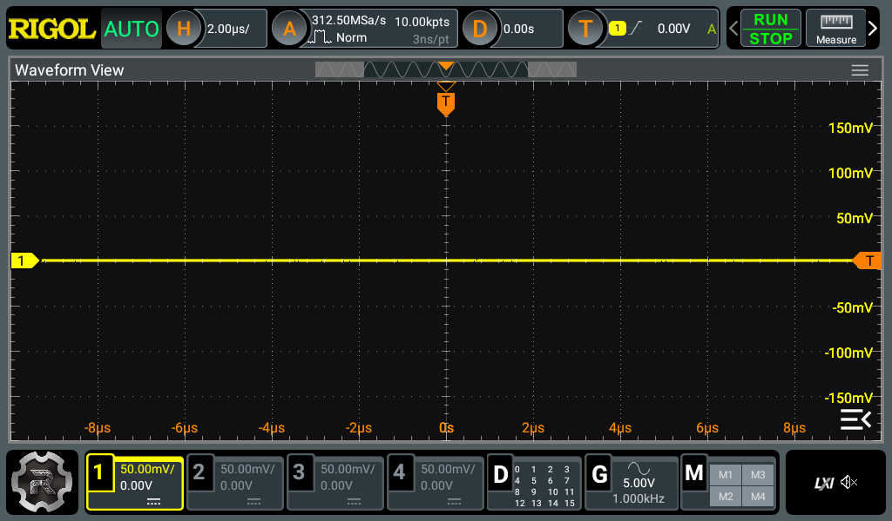

# rigol-mcp

[](https://github.com/eljefedelrodeodeljefe/rigol-mcp/actions/workflows/ci.yml)
[](https://github.com/eljefedelrodeodeljefe/rigol-mcp/releases)
[](LICENSE)
[](https://modelcontextprotocol.io)

**Let an AI agent drive your bench: RIGOL power supplies and oscilloscopes over SCPI, with
safety limits enforced in the library, not in the prompt.**

A Rust SDK and an [MCP](https://modelcontextprotocol.io) server. Point Claude Code, Cursor or
any MCP client at a DP800 power supply and a DHO800/DHO900 oscilloscope, and ask it to power a
rail and catch the rise on the scope.



*The scope's screen as an agent sees it — returned as an image by `get_screenshot`.*

## Supported instruments

| Family (`RIGOL_FAMILY`) | Models | Verified against |
|---|---|---|
| `dp800` (default) | DP811, DP821, DP831, DP832, DP832A | DP832A, firmware `00.01.19` |
| `dho900` | DHO802, DHO804, DHO812, DHO814, DHO914(S), DHO924(S) | DHO924S, firmware `00.01.05` |

One process drives one instrument. A PSU and a scope are two server entries, each with its own
address and its own write gate — so a scope can be fully writable while the PSU stays read-only,
and a stuck scope session can never block a PSU `output_off`.

## Safety

**This drives real power into real hardware.** A wrong write does not cost you
connectivity, it costs you a board. Three things follow from that:

1. **Ceilings are enforced in the library**, below the MCP layer. No tool argument, prompt,
   or future caller can bypass them — callers never see the check, they just get an error.
   - PSU: per channel, volts and amps.
   - Scope signal generator: amplitude, and the **peak** `|offset| + amplitude/2` — the
     value that actually reaches the device under test. Each can be in range while the
     pair is not.
2. **A ceiling is never unlimited.** Unconfigured, it defaults to what the hardware can do:
   the channel's own rating on a PSU (30V/3A, 30V/3A, 5V/3A on a DP832A), the generator's own
   10 Vpp / 5 V peak on a scope.
3. **Configuring and energising are separate operations.** Setting a voltage never turns a
   PSU output on; configuring the generator never turns its output on. Every energisation is
   explicit and logged, and the generator re-checks its settings at output-on, in case they
   were changed on the front panel. When the generator output is already on, settings change
   in an order that keeps every intermediate state inside the ceilings too.

A refused value comes back as an MCP *invalid params* error, not an internal error — so a
model understands it should lower the value rather than retry the same call.

`RIGOL_ALLOW_WRITES` gates mutating tools, but understand what it is: **a convenience
guard, not a security boundary.** Anyone who can reach tcp/5555 can drive the instrument
directly, with or without this server. It protects against an agent making a mistake, not
against an attacker.

The ceilings likewise constrain *this client only*. The front panel and any other LAN
client are unaffected. This is not a hardware interlock.

## Install

**Release binary** (Linux and macOS, x86_64 and aarch64) — download from
[Releases](https://github.com/eljefedelrodeodeljefe/rigol-mcp/releases), unpack, and put
`rigol-mcp` on your `PATH`. Each release also carries a CycloneDX and SPDX SBOM.

**With cargo:**

```sh
cargo install --locked --git https://github.com/eljefedelrodeodeljefe/rigol-mcp rigol-mcp
```

**From source:**

```sh
git clone https://github.com/eljefedelrodeodeljefe/rigol-mcp.git
cd rigol-mcp
cargo build --release   # binary at target/release/rigol-mcp
```

## Use with an MCP client

Claude Code, one instrument:

```sh
claude mcp add rigol-scope --env RIGOL_FAMILY=dho900 --env RIGOL_HOST=192.0.2.20 -- rigol-mcp
```

A PSU and a scope side by side, in `.mcp.json`:

```json
{
  "mcpServers": {
    "rigol-psu": {
      "command": "rigol-mcp",
      "env": {
        "RIGOL_FAMILY": "dp800",
        "RIGOL_HOST": "192.0.2.10",
        "RIGOL_CH1_MAX_VOLTS": "3.6",
        "RIGOL_CH1_MAX_AMPS": "0.5"
      }
    },
    "rigol-scope": {
      "command": "rigol-mcp",
      "env": {
        "RIGOL_FAMILY": "dho900",
        "RIGOL_HOST": "192.0.2.20",
        "RIGOL_ALLOW_WRITES": "true",
        "RIGOL_GEN_MAX_VPP": "3.3",
        "RIGOL_GEN_MAX_PEAK_VOLTS": "1.65"
      }
    }
  }
}
```

Here the scope is writable and the PSU is read-only. An agent can arm the scope with `single`,
and you switch the rail on yourself — or set `RIGOL_ALLOW_WRITES` on the PSU too, once you
trust the ceilings.

## Tools

### Power supply (`RIGOL_FAMILY=dp800`)

| Tool | What it does | Gate |
|---|---|---|
| `get_identity` | Vendor, model, serial, firmware (`*IDN?`) | — |
| `get_channel` / `list_channels` | Rating and setpoints (`:APPLy?`) | — |
| `measure_channel` | Delivered volts, amps, watts (`:MEASure:ALL?`) | — |
| `get_output_state` | Output on or off (`:OUTPut?`) | — |
| `get_protection` | OVP/OCP levels and trip state | — |
| `get_safety_limits` | Ceilings in force | — |
| `get_lan_config` / `get_instrument_errors` | LAN subsystem, error queue | — |
| `set_voltage` / `set_current` | Setpoints, refused above the ceiling | writes |
| `set_protection` | OVP/OCP trip levels | writes |
| `output_on` / `output_off` | Energise or de-energise a channel | writes |

### Oscilloscope (`RIGOL_FAMILY=dho900`)

| Tool | What it does | Gate |
|---|---|---|
| `get_screenshot` | The screen, as an image (`:DISPlay:DATA? PNG`) | — |
| `get_status` | Trigger, timebase, acquisition, every channel | — |
| `measure` | One automatic measurement (`:MEASure:ITEM?`); `null` when unmeasurable | — |
| `measure_statistics` | Current/min/max/average/deviation/count for one measurement (`:MEASure:STATistic:ITEM?`) | — |
| `get_waveform` | A trace in volts/seconds, thinned to min/max buckets, with full-capture stats | — |
| `get_identity` / `get_lan_config` / `get_instrument_errors` | Identity (with channel count), LAN, error queue | — |
| `get_generator` | Signal generator state and its ceilings | — |
| `run` / `stop` / `single` / `autoset` | Acquisition control | writes |
| `configure_channel` / `configure_timebase` / `configure_edge_trigger` | Setup; returns what the scope actually holds. The edge trigger takes an analog channel or a digital channel D0–D15 | writes |
| `clear_measurements` | Empty the on-screen measurement list | writes |
| `reset_measurement_statistics` | Restart every item's statistics (`:MEASure:STATistic:RESet`) | writes |
| `configure_generator` | Waveform, frequency, amplitude, offset — output stays off | writes |
| `generator_output_on` / `generator_output_off` | Drive or stop the signal | writes |

Every tool's description names the SCPI command it sends, in Programming Guide terms.

## Configuration

| Variable | Default | Purpose |
|----------|---------|---------|
| `RIGOL_HOST` | *(required)* | Instrument address |
| `RIGOL_FAMILY` | `dp800` | `dp800` or `dho900`; checked against `*IDN?` on connect |
| `RIGOL_PORT` | `5555` | Raw SCPI socket |
| `RIGOL_TIMEOUT_MS` | `5000` | Read timeout |
| `RIGOL_ALLOW_WRITES` | `false` | Must be `true` for any mutating tool |
| `RIGOL_CH<n>_MAX_VOLTS` / `_MAX_AMPS` | channel rating | PSU ceiling, `n` = 1–3, set together |
| `RIGOL_GEN_MAX_VPP` / `RIGOL_GEN_MAX_PEAK_VOLTS` | 10 / 5 | Scope generator ceilings, set together |

## The `rigol` library

The [`rigol`](crates/rigol) crate is usable without MCP: `Dp800` and `Dho900` device models,
the safety ceilings, and a `Session` that frames SCPI over a raw TCP socket (one command in
flight, binary block reads, reconnect after a failed exchange so a late reply can never be
paired with the next query). Enable its `schemars` feature for JSON Schema on the parameter
enums.

```sh
cargo run -p rigol --example probe -- 192.0.2.20
```

The probe is read-only by default. It identifies the instrument; for a scope it prints a table
of every query the firmware accepts. `--write` adds a fixed list of display, trigger and
logic-analyser set commands, each read, set, read back and error-checked, then puts every
setting back. It never touches the signal generator.

## Firmware quirks worth knowing

### DP800

Measured against a DP832A on `00.01.19`. Several of these contradict the DP800 Programming
Guide, and cost real time to rediscover:

- **The raw SCPI port is 5555.** tcp/5025 — the LXI-conventional one — is closed. tcp/111
  serves VXI-11 via ONC-RPC portmap, but the raw socket has identical capability without
  the XDR machinery, so this crate does not implement VXI-11.
- **Abbreviated command forms win.** `:OUTP:OVP:ALAR?` is accepted; the guide's long-form
  `:OUTP:OVP:ALARm?` is rejected with `-113 Undefined header`.
- **The alarm queries answer `YES`/`NO`**, not `ON`/`OFF` like the state queries.
- **Several documented LAN queries do not exist here.** `:SYST:COMM:LAN:SMAS?`, `:AIP?`,
  `:MANU?` and `:VISA?` all return empty and push `-113`. The accepted spellings are
  `:MASK?`, `:AUTO?`, `:MAN?` — and even `:MASK?` returns an empty string, so "supported"
  and "populated" are separate facts. `get_lan_config` probes rather than assumes.
- **`:APPL? CHn` returns the channel rating *and* its setpoints** in one reply:
  `CH1:30V/3A,0.000,3.000`. That rating is what seeds an unconfigured safety ceiling.
- **The MAC comes back hyphen-separated** (`00-19-AF-…`); the library normalises it to colons.
- **The instrument is fragile under scanning.** A full `nmap -p-` sweep wedged it for about
  ninety seconds — it stopped answering entirely. Probe sequentially. Nothing in this crate
  sweeps.
- **It advertises no mDNS/LXI record**, so there is no name to discover it by. Address it
  by IP, or find it by its Rigol OUI `00:19:AF` in an ARP table.
- Latency is comfortable — around 10–110 ms per query on a quiet LAN. The 5 s default
  timeout is generous on purpose, not because the instrument is slow.

### DHO800/DHO900

Measured against a DHO924S on `00.01.05`:

- **Send each command and its newline in one TCP segment.** With `TCP_NODELAY`, a command
  written in two pieces loses its reply about one time in nine — it looks exactly like an
  unsupported command timing out. The library always sends one write per command.
- **An unsupported query gets no reply at all**, not an error. That is why every parameter
  in this crate is a closed enum: there is no way to send a spelling the firmware has not
  been seen to accept.
- **`9.9E37` means "cannot measure"** (a frequency with no edges on screen). `measure`
  returns `null` for it.
- **`:MEASure:ITEM?` is not a pure read**: it also adds the item to the scope's on-screen
  measurement list, as the front panel would. `clear_measurements` removes them.
- **Older-series spellings don't apply.** Autoscale is `:AUToset`, and `:MEASure:CLEar` takes
  no parameter (`:MEASure:CLEar ALL` is `-108 Parameter not allowed`).
- **Waveforms default to `WORD` format**: 16-bit, little-endian. Volts are
  `(raw − yorigin − yreference) × yincrement` from `:WAVeform:PREamble?`.
- **The MAC's case depends on the interface** — upper-case over LAN, lower-case over USB.
  The library normalises it.
- **The error queue uses `-100,"Command err"`** where a DP832A says `-113`.
- Latency is 23–55 ms per query on a direct link; a 1024×600 PNG screenshot takes ~300 ms.

## Contributing

Conventions, layout and the safety rules any change must keep are in [AGENTS.md](AGENTS.md).
Every change goes through a pull request; CI runs the same `prek` hooks as a local commit.

## Licence

MIT.
